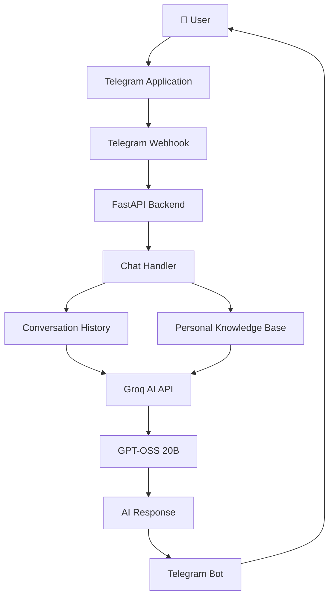

# 💜 Kyla – Your Personal AI Assistant

<p align="center">
  <strong>A friendly, intelligent, and personalized AI companion powered by Groq and Telegram.</strong>
</p>

<p align="center">
  A personal AI chatbot that remembers your context, understands your background, answers questions, and provides helpful conversations — anytime, anywhere.
</p>

<p align="center">
  
  
  
  
  
</p>

---

## 🌟 Overview

**Kyla** is a personalized AI assistant designed to be more than just a traditional chatbot.

Powered by Groq's high-performance AI inference and integrated with Telegram, Kyla provides a natural conversational experience with personalized knowledge about its owner.

Unlike generic AI chatbots, Kyla has a dedicated personal knowledge base containing information about education, technical skills, projects, internships, achievements, certifications, and career goals.

Kyla is designed to act as a friendly AI companion while also serving as a personal information assistant.

Whether it is casual conversation, technical questions, programming assistance, or questions about its owner's background, Kyla aims to provide useful and personalized responses.

> 💜 Meet Kyla — Your personal AI companion, always ready to chat.


<a href="https://t.me/kkyla_bot" target="_blank"
   style="display: inline-flex; align-items: center; gap: 120px; text-decoration: bold;">
  
       <br>
  <span style="display: inline-flex; align-items: center;">
    💜 Try Kyla on Telegram – Click Here!
  </span>
</a>

---

## ✨ Features

### 🤖 AI-Powered Conversations
- Natural language conversations powered by Groq.
- Uses the `openai/gpt-oss-20b` model.
- Fast AI inference.
- Context-aware responses.
- Friendly and adaptive conversational personality.

### 🧠 Personalized Knowledge Base
Kyla has a dedicated personal knowledge base containing:

- Personal profile.
- Educational background.
- Technical skills.
- Programming experience.
- Projects and development work.
- Internships.
- Awards and achievements.
- Certifications.
- Career goals.
- Personal interests.

This allows Kyla to answer questions about its owner without requiring the information to be repeated in every conversation.

### 💬 Telegram Integration
- Interact with Kyla directly through Telegram.
- `/start` – Start interacting with Kyla.
- `/about` – Learn about Kyla.
- Send normal text messages to start conversations.
- Receive AI-generated responses directly in Telegram.

### 🔄 Conversation Context
- Maintains recent conversation history per Telegram user.
- Sends previous messages to the AI model for contextual responses.
- Supports conversational continuity.
- Limits stored history to avoid unnecessary context growth.

### ⚡ Asynchronous Processing
- Uses `AsyncGroq` for asynchronous AI requests.
- Uses asynchronous Telegram handlers.
- Integrates with FastAPI.
- Supports webhook-based Telegram updates.

### 🛡️ Error Handling
- Groq authentication error handling.
- Groq API error handling.
- Empty AI response handling.
- Telegram application error logging.
- Unexpected exception handling.
- User-friendly fallback messages.

### ☁️ Cloud Deployment
- FastAPI backend.
- Vercel serverless deployment.
- Environment-based secret management.
- Telegram webhook integration.

---

## 🏗️ System Architecture



### Request Processing

1. A user sends a message through Telegram.
2. Telegram forwards the update to the configured webhook.
3. FastAPI receives the webhook request.
4. The chat handler extracts the user's message.
5. Recent conversation history is retrieved.
6. The system prompt and personal knowledge base are included.
7. The request is sent to Groq.
8. Groq generates an AI response.
9. The response is processed and validated.
10. Kyla sends the generated response back through Telegram.

---

## 🛠️ Technology Stack

| Technology | Purpose |
|---|---|
| Python | Core programming language |
| FastAPI | Backend API framework |
| python-telegram-bot | Telegram bot integration |
| Groq API | AI inference |
| GPT-OSS 20B | Language model |
| AsyncGroq | Asynchronous AI requests |
| Vercel | Cloud deployment |
| Python Logging | Error tracking |

---

## 📂 Project Structure

```text
Kyla/
│
├── api/
│   └── index.py
│
├── requirements.txt
│
├── vercel.json
│
├── .gitignore
│
└── README.md
```

### File Descriptions

| File | Description |
|---|---|
| `api/index.py` | Main FastAPI application and Telegram bot logic |
| `requirements.txt` | Python dependencies |
| `vercel.json` | Vercel deployment configuration |
| `.gitignore` | Excludes sensitive and unnecessary files |
| `README.md` | Project documentation |

The personal knowledge base and system prompt are currently maintained inside `api/index.py`.

---

## ⚙️ Installation and Setup

### 1. Clone the Repository

```bash
git clone https://github.com/Venkie07/tell.git

cd Kyla
```

Replace the repository URL if your actual repository uses a different name.

### 2. Create a Virtual Environment

```bash
python -m venv venv
```

Activate it on Windows:

```bash
venv\Scripts\activate
```

Activate it on Linux/macOS:

```bash
source venv/bin/activate
```

### 3. Install Dependencies

Create a `requirements.txt` file:

```txt
fastapi
uvicorn
python-telegram-bot
groq
```

Install the dependencies:

```bash
pip install -r requirements.txt
```

### 4. Configure Environment Variables

Create a `.env` file for local development:

```env
BOT_TOKEN=your_telegram_bot_token
GROQ_API_KEY=your_groq_api_key
```

**Important:** Never upload `.env` to GitHub.

For local development, load the variables using `python-dotenv` if needed.

Install it:

```bash
pip install python-dotenv
```

Add this at the beginning of `api/index.py`:

```python
from dotenv import load_dotenv

load_dotenv()
```

---

## 🔑 API Key Configuration

### Telegram Bot Token

1. Open Telegram.
2. Search for [@BotFather](https://t.me/BotFather).
3. Create a new bot using `/newbot`.
4. Follow the instructions.
5. Copy the generated bot token.
6. Save it as `BOT_TOKEN`.

### Groq API Key

1. Visit [Groq Console](https://console.groq.com/keys).
2. Sign in to your account.
3. Generate an API key.
4. Copy the key.
5. Save it as `GROQ_API_KEY`.

Never expose these credentials in source code, public repositories, screenshots, or logs.

---

## 🚀 Running Locally

Start the FastAPI application:

```bash
uvicorn api.index:app --reload
```

The application will be available at:

```text
http://127.0.0.1:8000
```

Check the health endpoint:

```text
http://127.0.0.1:8000/
```

Expected response:

```json
{
  "status": "Kyla is alive 💜",
  "ai": "Groq",
  "bot": "Telegram"
}
```

For Telegram interaction, configure a publicly accessible webhook URL pointing to your local development server using a suitable tunneling service.

---

## ☁️ Deployment on Vercel

Kyla can be deployed using Vercel.

### Step 1: Push to GitHub

```bash
git add .
git commit -m "Initial Kyla AI assistant setup"
git push origin main
```

### Step 2: Import into Vercel

1. Visit [Vercel](https://vercel.com/).
2. Import your GitHub repository.
3. Configure the project.
4. Add the required environment variables.

### Step 3: Configure Environment Variables

Add the following variables in:

**Vercel Dashboard → Project → Settings → Environment Variables**

| Variable | Value |
|---|---|
| `BOT_TOKEN` | Telegram bot token |
| `GROQ_API_KEY` | Groq API key |

Mark sensitive variables as sensitive where supported.

### Step 4: Deploy

Deploy the project and obtain your Vercel deployment URL.

Example:

```text
https://your-project.vercel.app
```

### Step 5: Configure Telegram Webhook

Use the following Telegram Bot API endpoint:

```text
https://api.telegram.org/bot<YOUR_BOT_TOKEN>/setWebhook?url=https://your-project.vercel.app/webhook
```

Replace the placeholders with your actual values.

Keep your bot token private. Do not commit the webhook URL containing the token.

Once the webhook is configured, Telegram will forward incoming updates to Kyla.

---

## 🔗 API Endpoints

| Method | Endpoint | Description |
|---|---|---|
| GET | `/` | Application health check |
| POST | `/webhook` | Receives Telegram updates |

### Health Check

```http
GET /
```

### Telegram Webhook

```http
POST /webhook
```

Receives Telegram update JSON and processes it through the Telegram application.

---

## 🧠 Personal Knowledge System

One of Kyla's main capabilities is its personalized knowledge base.

The system prompt provides information about its owner, allowing the AI to answer questions using predefined context.

### Knowledge Categories

| Category | Information |
|---|---|
| Personal Profile | Name, location, portfolio |
| Education | Degree, college, GPA |
| Skills | Programming and development skills |
| Projects | Personal and academic projects |
| Internships | Professional experience |
| Achievements | Coding rankings and awards |
| Certifications | NPTEL and other certifications |
| Career Goals | Target roles and placement preparation |

### Example Questions

Users can ask:

- Who is Venkateswaran?
- What does he study?
- What programming languages does he know?
- What is his SkillRack ranking?
- Tell me about his projects.
- What is Milo?
- What is Pocket AI?
- Where did he complete his internship?
- What are his career goals?
- What achievements has he earned?

Kyla uses the personal knowledge base to generate relevant responses.

---

## 💬 Example Conversations

**User:**
Who is Venkateswaran?

**Kyla 💜:**
Venkateswaran K, also known as Venkie, is an Artificial Intelligence and Data Science student at Sri Sairam Institute of Technology, Chennai. He's passionate about software engineering, AI, programming, and building practical technology projects.

**User:**
Tell me about his coding achievements.

**Kyla 💜:**
Venkie has solved over 3,400 programming problems on SkillRack and reached approximately the 250th position among 35,000+ users. He has also maintained a 500-day coding streak! 💜

**User:**
What is his most interesting project?

**Kyla 💜:**
One interesting project is Pocket AI, a portable local AI development environment designed to run AI models and development tools from a USB drive. He's also developing Milo, an AI-powered personal desktop wellness companion.

---

## 🔒 Security Considerations

Security is an important part of the project.

- Store API keys using environment variables.
- Never hardcode Telegram or Groq credentials.
- Mark sensitive environment variables appropriately in Vercel.
- Never commit `.env` files.
- Rotate exposed credentials immediately.
- Avoid logging API keys and private user data.
- Validate incoming webhook requests.
- Consider restricting webhook access using Telegram's webhook secret token.
- Use appropriate request and rate limits in production.

---

## ⚠️ Current Limitations

The current implementation has some limitations:

1. Conversation history is stored in application memory and may be lost when a serverless instance restarts.
2. Personal knowledge is embedded in the system prompt and must be updated manually.
3. There is no persistent database for conversations.
4. The bot currently processes text messages rather than providing full multimodal interaction.
5. The application does not currently implement user-specific long-term memory storage.
6. Webhook authentication and production rate limiting require additional configuration.

---

## 🔮 Future Enhancements

Potential improvements include:

- Persistent conversation memory using PostgreSQL or SQLite.
- Retrieval-Augmented Generation (RAG).
- Dynamic personal knowledge updates.
- GitHub API integration for retrieving recent repositories and activity.
- Document and PDF understanding.
- Voice message interaction.
- Speech-to-text and text-to-speech.
- Multimodal AI capabilities.
- User authentication and access controls.
- Personalized reminders and task management.
- More advanced AI agent capabilities.
- Improved monitoring and analytics.

---

## 🎯 Project Goals

Kyla aims to demonstrate how modern AI technologies can be combined to create a personalized conversational assistant.

The main goals are:

- Build an accessible personal AI companion.
- Integrate large language models into everyday communication.
- Provide personalized knowledge-based responses.
- Explore asynchronous backend development.
- Understand AI API integration and cloud deployment.
- Build a scalable foundation for future AI agent capabilities.

---

## 👨‍💻 Developer

**Venkateswaran K (Venkie)**

B.Tech – Artificial Intelligence and Data Science  
Sri Sairam Institute of Technology, Chennai

- Portfolio: https://venkateswaran-k.web.app
- GitHub: https://github.com/Venkie07

---

## 📜 License

This project is currently maintained as a personal AI assistant project.

A license can be added when the project is ready for public distribution.

---

<p align="center">
  Made with 💜 by Venkie
</p>

<p align="center">
  <strong>Kyla – More than a chatbot. A personal AI companion.</strong>
</p>
